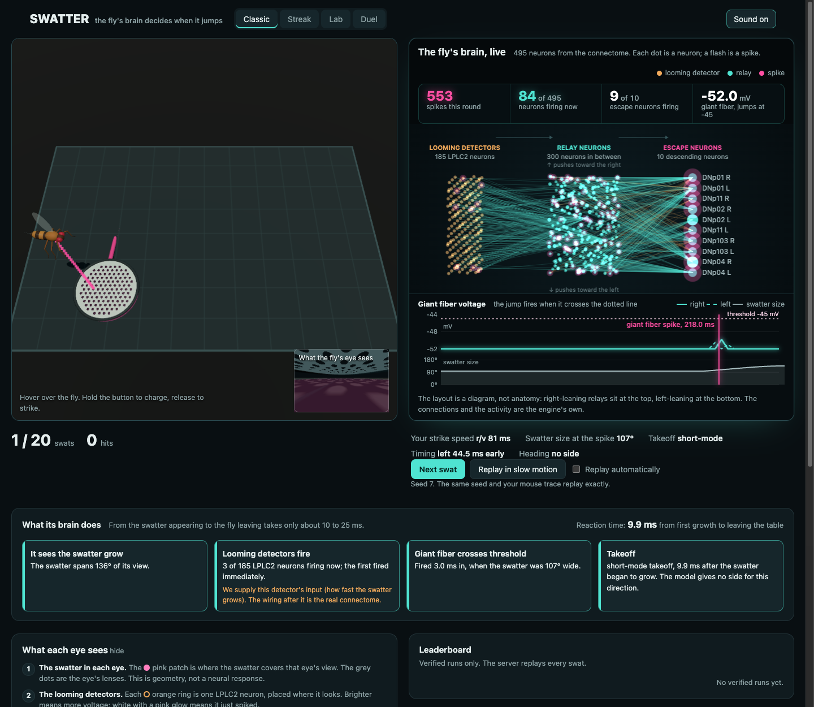

# SWATTER

**A browser game where a fruit fly's real escape circuit is your opponent.**

**[Play it](https://hemish22.github.io/swatter-flybody/)** · runs in the browser, needs WebGL · desktop with a mouse works best



You hover a swatter over a fly. The fly sees it grow, and a 495-neuron slice of the fly connectome decides when and
which way it jumps. Whether you hit it depends on that decision, and the page shows the decision as it happens: the
looming-detector neurons firing, the spike reaching the giant fiber, the takeoff, and a slow-motion replay of the last
300 ms after every swat. The animated fly only plays back what the neurons already decided.

## How to play

Move the mouse to hover the swatter over the fly. **Hold the button to charge** a strike (the tone rises), **release to
swing**. A fly reacts within about 10 to 25 ms of the swatter starting to grow, so a hit needs a full charge and a slow,
quiet approach. A fast mouse spooks it before you strike. Classic is 20 swats scored by hits; Streak ends after three
misses in a row; Lab lets you fire the standard loom stimuli at a tethered fly and plot the response.

## What it is made of

- **The brain:** the escape circuit of MaleCNS v1.0 (185 LPLC2 looming detectors, 300 relay neurons, 10 descending
  neurons, 42,396 connections) as a leaky integrate-and-fire network, in the form and constants of
  [Shiu et al. 2024](https://pmc.ncbi.nlm.nih.gov/articles/PMC11446845/). Written in Rust, compiled to a 31 KB WebAssembly
  module, deterministic (a swat is a function of its seed and cursor trace).
- **The game and page:** TypeScript, three.js for the 3D table and a procedural fly, Canvas2D for the live circuit and
  voltage traces, Web Audio for synthesised sound. No assets, no framework. The deployed site is a static folder.
- **The offline pipeline:** Python and PyTorch on a GPU server: connectome extraction, the LIF parameter fit with a
  held-out set, the validation plots and ablations, a Brian2 cross-check against the original model, and a parity test
  that holds the Python, Rust/WASM and TypeScript engines to the same 50 stimuli.
- **Optional leaderboard server** (Node, SQLite) that replays every submitted run with the same game code. The public
  site runs without it.

## What is real and what is modelled

Read this before taking the page at face value; the same text is in the UI.

- **Real:** the looming-detector and escape-neuron populations, and the synapse counts and signs between them, from the
  connectome.
- **Supplied by me:** the looming detector's *input*. The detector fires on how fast the swatter grows; the fly's optic
  lobe was built and tested but could not separate looming from translating discs, so it is not used
  ([`docs/week1_gate.md`](docs/week1_gate.md)). Everything after that input is the connectome.
- **Does not reproduce:** the published trend of takeoff mode with loom speed. Every escape comes out short-mode, and
  no setting of the fitted parameters changes that ([`docs/lif_fit.md`](docs/lif_fit.md)).
- **Provisional:** the three fitted parameters. A Brian2 cross-check found the constants match the original model but
  the neuron's behaviour around its own spike differs, so spike timing is specific to this engine
  ([`docs/lif_fit.md`](docs/lif_fit.md)). Selectivity and heading side hold up.
- **An illustration:** the fly's body, drawn about 13 times life size. Heading is a side (left or right), not an angle.
- **My game rules, not the plan's:** a 40 mm hover and hold-to-charge strikes, because under the original rules no
  strike can land ([`docs/game.md`](docs/game.md)). Nobody has playtested it beyond the author.

## Run it

```sh
cd web
npm ci
npm run build
node ../server/server.ts            # serves the game and the optional leaderboard on http://localhost:8080
```

or build the static site and serve `web/site` with any file server:

```sh
npm run build:site
```

Checks: `npx tsc -p .` and `npm test` (38 tests, Node 24 or later); `./browser_check.sh` runs the in-browser parity set and
scripted rounds in headless Chrome. The Python side needs a GPU and the 1 GB connectome download, and is run on a server:
see [`docs/dev-notes.md`](docs/dev-notes.md) and `scripts/dgx.sh`.

## Where to look

| | |
| --- | --- |
| `web/game/` | world model and round simulation (`world.ts`), the page (`main.ts`), 3D stage, circuit view, sound |
| `web/engine/`, `engine/` | TypeScript glue and the Rust/WASM LIF engine |
| `offline/` | the Python pipeline: extraction, LIF reference, fit, validation, Brian2 check |
| `docs/` | design notes with the measurements: `game.md`, `lif_fit.md`, `validation.md`, `engine.md` |
| `server/` | optional leaderboard and replay verifier |

## Credits

- Connectome: MaleCNS v1.0 from the FlyEM project at HHMI Janelia and collaborators, downloaded from their public
  bucket. `web/brain/brain.bin` holds the edges and signs of a 495-neuron subgraph; please check the data provider's
  terms before reusing it.
- Circuit model: Shiu et al. 2024, *A Drosophila computational brain model reveals sensorimotor processing*.
- Biology: Ache et al. 2019 (looming size and velocity in the giant fiber pathway); von Reyn et al. 2014 and 2017 (takeoff
  mode and the giant fiber).
- Optic-lobe experiments: the `flyvis` model, used offline only.
- three.js (MIT) renders the table.

## License

MIT, see [`LICENSE`](LICENSE). The connectome data keeps its own terms.
